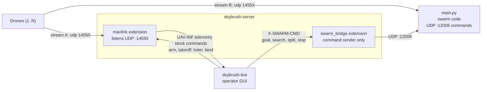

# Swarm GCS — architecture & run guide

This covers the GUI/GCS layer built on top of the `swarm_tasks` library
(see `README.md` for that). Three programs take part:

- **`main.py`** (swarm code) — holds its own MAVLink/dronekit connection to
  every drone, runs the guidance/kinematics logic (`swarm.py`), and listens
  for swarm commands over UDP.
- **`skybrush-server`** — the GCS back end. Its standard `mavlink` extension
  receives each drone's telemetry; this project's `swarm_bridge` extension
  forwards swarm operations to `main.py`.
- **`skybrush-live`** — the operator web GUI. It only talks to the server.

## Two independent data paths per drone

Each drone sends **two separate MAVLink streams**:

- **Stream A** (`serial1`, UDP port 14550) goes to the server's `mavlink`
  extension. This is what Live shows: position, battery, flight mode, and
  the stock arm / takeoff / loiter / land / RTH controls.
- **Stream B** (`serial2` / `serial4`, UDP ports 14551, 14552, ...) goes to
  `main.py`. The swarm code uses it to fly goals, searches and splits.



- **Telemetry**: drone → server `mavlink` extension → Live. `main.py` is not
  involved, so Live keeps working if `main.py` is down.
- **Stock vehicle commands** (arm, disarm, takeoff, loiter, land, RTH): Live →
  server `mavlink` extension → drone.
- **Swarm commands**: Live sends one `X-SWARM-CMD` message → `swarm_bridge`
  builds the exact text string `main.py` expects → one UDP datagram to
  `command_host:command_port`. The datagram is tagged `|id=<token>`, and
  `main.py` replies to the sender with `ACK <id> received` at once, then
  `ACK <id> accepted` or `REJECT <id> <reason>` once it has parsed and started
  the command. The bridge waits for that (1.5 s for receipt, 20 s for the
  verdict) and answers Live, which shows a rejection or a missing reply as an
  error toast. A command without the `|id=` tag (for example from
  `send_command_example.py`) still works and gets no reply.

## UAV ids

Skybrush names a UAV from its MAVLink system id, and so does the swarm: a
bot's id is its drone's system id. `main.py` sorts the connected drones by
system id (so connection order and UDP port do not matter), keeps each bot's
id in `Bot.sysid`, and translates the system ids it receives in `goal`,
`split`, `specificsplit`, `remove` and `add` into its internal bot positions.
Its telemetry endpoint reports the same system ids. Every drone needs a
unique `SYSID_THISMAV`. `id_map` in `swarm.jsonc` (Skybrush id → id sent to
`main.py`) is only needed if the two ever differ; ids you do not list pass
through unchanged.

## Takeoff altitude and loiter

- **Takeoff** opens a prompt for the altitude in meters above home (default
  10, remembered between uses). Live sends it as `altitude` in `UAV-TAKEOFF`.
  Without a value the server uses 2.5 m
  (`DEFAULT_TAKEOFF_ALTITUDE_M` in `ext/mavlink/driver.py`).
- **Loiter** (the flag button) sets **Loiter** on a copter (mode 5) and
  **QLoiter** on a quadplane, so a VTOL hovers instead of circling.
- **Guided mode** (the arrow button beside it) sends the server's `mode`
  command with `guided` to every selected UAV. The server maps the name to the
  right mode number per autopilot (ArduCopter 4, ArduPlane 15).

## The swarm command set

Every command below is handled by `main.py`'s dispatch loop and sent over UDP
port `12008` as one of these strings (see `send_command_example.py` for a
reference client, and `ext/swarm_bridge/driver.py` for the server's builder):

| Command | Wire format | What it does |
|---|---|---|
| `goal` | `goal_<json [[lat,lon],...]>_<direction>_<radius>_<json ids>` | Sends the listed bot ids to fly a waypoint path |
| `stop` | `stop` | Global stop of whatever is currently running |
| `search` | `search,<lat>,<lon>,<num_uavs>,<grid_space>,<coverage_area>` | Area-coverage search with every active bot |
| `split` | `split_<centers json>_<ids json>_<grid_space json>_<coverage_area json>` | Auto-splits coverage areas across the given bots |
| `specificsplit` | `specificsplit_<centers json>_<uav_array json>_<grid_space json>_<coverage_area json>` | Like `split`, but you pick which bots cover which area |
| `remove` | `remove_<json [id]>` | Self-heal: freeze a bot, hand its goals to the next free bot |
| `add` | `add_<json [id]>` | Bring a removed bot back |
| `different` | `different,<start>,<diff>` | Staggers every bot's altitude (`start + i*diff` meters) |

## Running it

### 1. Start the drones

Each drone must send stream A to the machine running `skybrush-server` on
UDP 14550 and stream B to `main.py`'s address on UDP 1455X. With the SITL
launcher this is automatic. Close any other ground-station app (for example
Mission Planner) that holds UDP port 14550.

### 2. Start `main.py`

```bat
run_main.bat <bind_ip> <num_bots>
```

For example `run_main.bat 172.24.96.1 3` for three SITL drones in WSL. It
prints `Ip address: <ip>`; that is the `command_host` for step 3.
`SWARM_IP` and `SWARM_NUM_BOTS` are the environment variables behind the two
arguments.

### 3. Configure and start the server

Edit `gui/skybrush-server/etc/conf/swarm.jsonc`:

```jsonc
"mavlink": { "enabled": true, "networks": { "mav": { "connections": ["default"] } } },
"swarm_bridge": {
  "enabled": true,
  "command_host": "<the IP main.py printed>",
  "command_port": 12008,
  "id_map": {}            // e.g. { "11": "1", "12": "2" } when ids differ
}
```

Then run `gui\skybrush-server\run_server.bat`. The log should show
`Connection at :14550 up and running` and
`swarm_bridge: commands go to udp://<host>:12008`.

### 4. Start Live

```bash
cd gui/live
npm install   # first time only
npm start
```

Open the URL it prints and connect to `localhost:5000` (the server runs on
the same machine as Live).

### 5. Fly

Drones appear in the UAVs list from their MAVLink heartbeats. Use the UAV
toolbar for takeoff, loiter, land and RTH, and the Swarm ops dialog for
goal, search and split.

## Troubleshooting

- **No drones in Live**: check the server log for `Connection at :14550` and
  `mav/<id>` lines. If missing, another program is holding UDP 14550, or the
  drones are not sending stream A to this machine.
- **Swarm commands do nothing**: look for `swarm_bridge: sent ...` in the
  server log. If present, check that `main.py` is running, that `command_host`
  is the address it bound to, and that no firewall blocks UDP 12008.
- **Commands act on the wrong drone**: the Skybrush and `main.py` ids differ;
  fill in `id_map`.
- **Only some drones connected to `main.py`**: its startup line
  `Number of Drones Connected: X/Y` shows failed connections; bot ids follow
  connection order.

## Terrain

The server's `terrain` extension (`ext/terrain/`) holds ground elevation (NASA
SRTM, 30 m, one `.hgt` file per 1 degree square) and everything else uses it:

- **Map overlay.** `GET /terrain/tiles/<z>/<x>/<y>.png?style=hillshade|relief`
  draws shaded relief. In Live, add a **Terrain** layer (Layers dialog); its
  settings set the style and opacity and have a "Download this area" button.
- **Drones.** ArduPilot asks the ground station for terrain with
  `TERRAIN_REQUEST`; `ext/mavlink/terrain.py` answers with `TERRAIN_DATA`
  blocks (layout from ArduPilot's `AP_Terrain`). Blocks with no known height
  are skipped, never sent as zero.
- **Warnings** (shown as warning toasts in Live; nothing is blocked):
  - A drone below `min_clearance_m` (30 m) above the ground, now or within
    `lookahead_s` (10 s) at its current velocity (`ext/terrain/clearance.py`).
  - After a goal, search, split or specific split is accepted, the route or
    area is checked at each drone's set height (`swarm_bridge/terrain_check.py`).
    Heights come from `main.py`'s `/api/telemetry` (`height`, metres above
    home); home altitude is the drone's altitude above sea level minus its
    altitude above home.
- **Offline.** Tiles are downloaded on first use and kept in the server's cache
  folder (`.../Cache/ext/terrain`). `prefetch_areas` in `swarm.jsonc` downloads
  chosen areas at start; `POST /terrain/prefetch {"lat","lon","radius_km"}` does
  it on demand. Ocean tiles do not exist at the source and read as 0 m.

Other routes: `GET /terrain/elevation?lat=&lon=`, `POST /terrain/profile`,
`GET /terrain/stats`, `GET /terrain/warnings`.

## Drone-show code

The drone light-show features were removed. The server's `mavlink` extension
still imports a few show types, so small no-op stubs remain in
`ext/show/`, `show/` and `ext/mavlink/_show_stubs.py`. They do nothing.

## Key files

| File | Role |
|---|---|
| `main.py` | Swarm code entry point: `Vehicles`/`Variables`/`Swarm` and the UDP command loop |
| `run_main.bat` | Starts `main.py` with a bind IP and drone count |
| `swarm.py`, `vehicle.py` | Guidance logic and dronekit connections |
| `swarm_tasks/network/UDP.py` | UDP command receiver (`main.py` side) |
| `gui/skybrush-server/src/flockwave/server/ext/swarm_bridge/` | Handles `X-SWARM-CMD` and sends the UDP commands |
| `gui/skybrush-server/etc/conf/swarm.jsonc` | Server config: `mavlink`, `command_host`, `id_map` |
| `gui/skybrush-server/run_server.bat` | Starts the server with that config |
| `gui/live/src/features/swarm-ops/` | Live dialog and `X-SWARM-CMD` actions |
